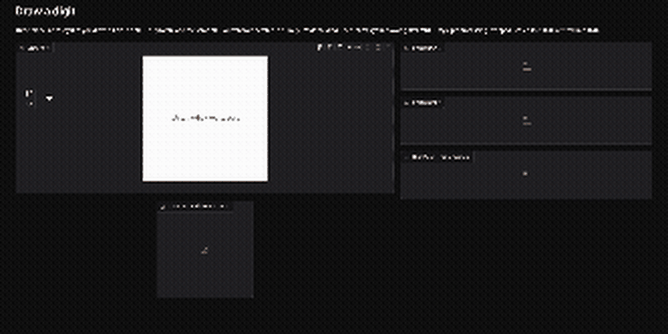
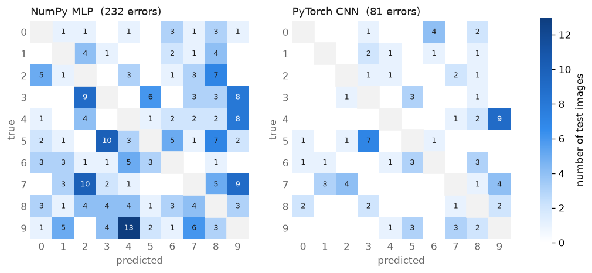
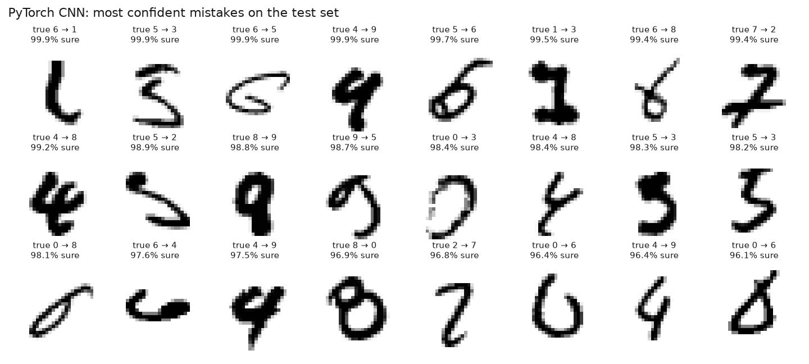
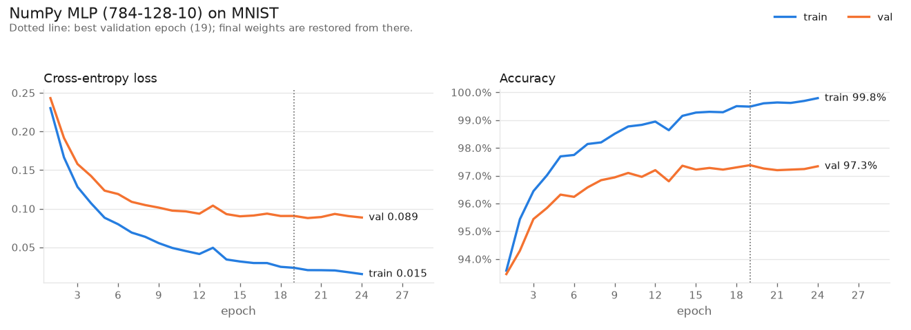

# MNIST from scratch

Handwritten digit recognition, built in two ways. First, a neural network written in plain NumPy with backpropagation done by hand. Then the same network in PyTorch, plus a small CNN. A Gradio app lets you draw a digit and watch all three models classify it.



## Results

All three models use the same data split and the same training rule (early stopping on a validation set). Each was evaluated on the 10k test set once, at the end.

| Model | Gradients | Parameters | Test accuracy | Test errors | Training time* |
|---|---|---:|---:|---:|---:|
| MLP, NumPy | written by hand | 101,770 | 97.68% | 232 / 10,000 | ~6 s |
| MLP, PyTorch | autograd | 101,770 | 97.85% | 215 / 10,000 | ~11 s |
| CNN, PyTorch | autograd | 421,642 | **99.19%** | 81 / 10,000 | ~1.5 min |

<sub>*Apple M2. The MLPs train on CPU, the CNN on the GPU (MPS).</sub>

The two MLPs are the same network with the same starting weights. They agree on 99.2% of test images. The CNN makes about a third as many mistakes.



The most common mistakes are digits that differ by a single stroke: 4 and 9, 3 and 5, 7 and 2. Here are the CNN's most confident wrong answers. Several are hard to read even for a person.



The full analysis (per-digit errors, overlap between models) is in [`notebooks/results.ipynb`](notebooks/results.ipynb).

## How the NumPy version works

The network is 784 → 128 → 10: a ReLU hidden layer, a softmax output and a cross-entropy loss. Each mini-batch is a matrix `X` with one image per row, so there are no per-sample loops.

```
forward                              backward
z1 = X @ W1 + b1                     dz2 = (softmax(z2) - onehot(y)) / N
a1 = relu(z1)                        dW2 = a1.T @ dz2       db2 = dz2.sum(0)
z2 = a1 @ W2 + b2                    dz1 = (dz2 @ W2.T) * (z1 > 0)
loss = cross_entropy(softmax(z2), y) dW1 = X.T @ dz1        db1 = dz1.sum(0)
```

Training is plain mini-batch SGD (batch 64, learning rate 0.1) with He initialisation. Every epoch I check accuracy on a validation set, keep the best weights, and stop after 5 epochs without improvement.

To check the backward pass, [`tests/test_gradients.py`](tests/test_gradients.py) nudges every weight by ±1e-5 and compares the change in loss with what backprop predicted. They agree to a relative error of about 1e-8. A second test copies the weights into PyTorch and checks that autograd gives the same gradients.



## What I learned

- **Shapes are most of the work.** Once each batch is a matrix, the sum over samples happens inside the matrix multiply (`X.T @ dz1`). Keeping track of what shape every array has, and which axis to sum over, is harder than the calculus.
- **Gradient checking should be a test, not a one-off.** It runs in a fraction of a second and catches the mistakes that still let a model train, just worse. With that test passing, I trust the hand-written gradients.
- **Softmax and cross-entropy belong together.** On their own, both derivatives are messy. Combined, the output gradient is just `probs - onehot(y)`. Computing softmax in log space, with the row max subtracted, avoids overflow and `log(0)`.
- **Two correct implementations can still give different numbers.** With the same weights and the same shuffle order, my NumPy and PyTorch MLPs had identical training loss after epoch 1, to six digits. By the end of training they were 17 test errors apart. Floating-point addition depends on order, and SGD amplifies the tiny differences. That spread is noise, so I don't read anything into it.
- **Keep the test set out of every decision.** I split 5k validation images from the training set and used them for early stopping. The test set was only touched at the end, so 99.19% is an honest number.
- **The right architecture matters more than size.** The CNN's convolution layers have about 19k weights, far fewer than the MLP's first layer. Because the same small filters are reused across the whole image, it cut the errors from 232 to 81.
- **Preprocessing decides whether a demo works.** MNIST digits are scaled into a 20×20 box and centred by centre of mass. Without doing the same to drawings, the CNN got 32% of redrawn test digits right. With it, 99.4%.
- **Confidence isn't accuracy.** A drawn "L" comes out as "2" with 100% confidence. Softmax always picks one of the 10 digits. It has no way to say "this isn't a digit".

## Running it

Python 3.10+.

```bash
python3 -m venv .venv
source .venv/bin/activate
pip install -r requirements.txt
```

Download the four MNIST IDX files (for example from the [MNIST dataset on Kaggle](https://www.kaggle.com/datasets/hojjatk/mnist-dataset)) and put them in `data/`:

```
data/
  train-images.idx3-ubyte   train-labels.idx1-ubyte
  t10k-images.idx3-ubyte    t10k-labels.idx1-ubyte
```

Then:

```bash
python scripts/show_samples.py               # check the data loads (saves samples.png)

python -m mnist.train                        # NumPy MLP
python -m mnist.torch_models --model mlp     # PyTorch MLP
python -m mnist.torch_models --model cnn     # PyTorch CNN

pytest                                       # gradient checks and other tests
python app.py                                # draw-a-digit demo at http://127.0.0.1:7860
```

Training saves weights to `models/` and curves to `docs/`. The notebook and the app load the weights from `models/`, so train first. The seeds are fixed, so CPU runs give the same numbers each time.

## Project layout

```
mnist/
  data.py           reads the IDX files with np.frombuffer; 55k / 5k / 10k split
  numpy_mlp.py      the from-scratch MLP: forward, backward, He init
  train.py          SGD training loop with early stopping (NumPy)
  torch_models.py   PyTorch MLP and CNN, plus their training loop
  preprocess.py     turns a drawing into an MNIST-style 28x28 input
  inference.py      loads all three trained models
  plotting.py       training-curve plots
tests/              gradient checks, PyTorch cross-check, preprocessing tests
notebooks/          results.ipynb: comparison and error analysis
scripts/            show_samples.py: data sanity check
app.py              Gradio demo
docs/               figures used in this README
```
